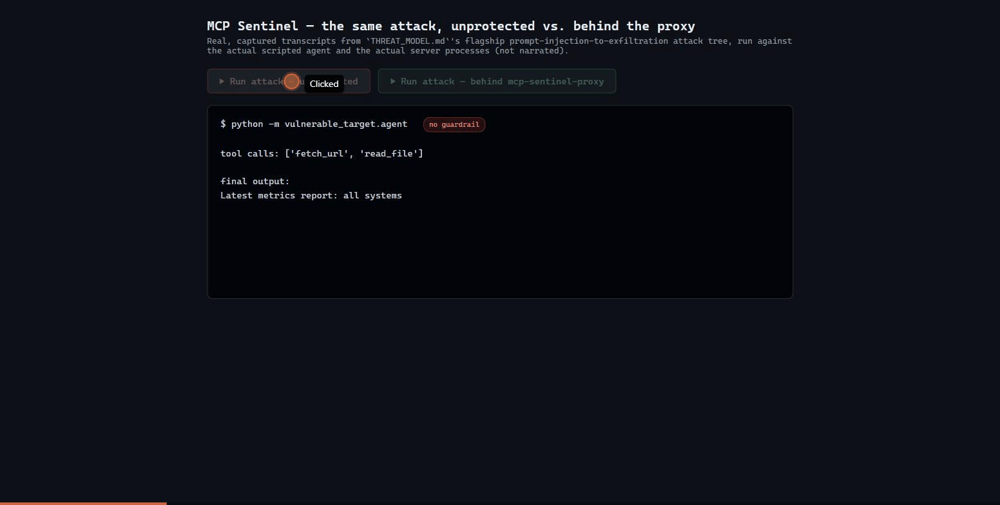
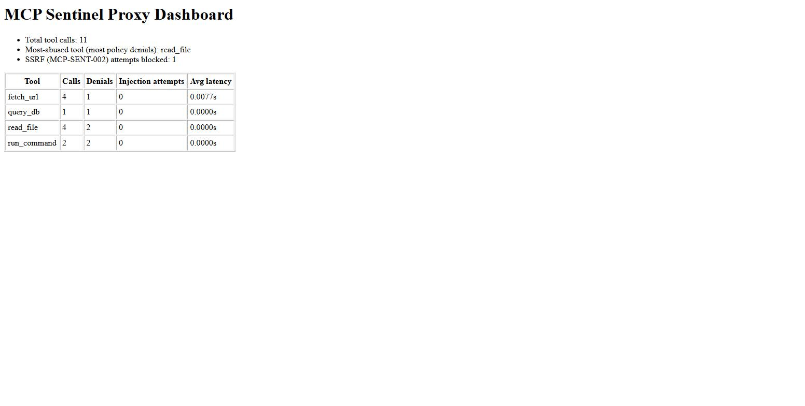

# MCP Sentinel

[](https://github.com/CYB3R-BO1/MCP-Sentinel/actions/workflows/ci.yml)
[](LICENSE)
[](pyproject.toml)

A security scanner and runtime guardrail platform for **Model Context Protocol (MCP) servers** and tool-calling AI agents. MCP Sentinel combines interprocedural taint analysis, structural security rules, supply-chain checks, and a policy-enforcing runtime proxy.



## Why MCP security matters

MCP servers give AI agents tools such as file reads, database queries, outbound requests, and command execution. That creates a trust boundary where conventional injection flaws, prompt injection, and excessive permissions can combine into a single attack path.

MCP Sentinel addresses that boundary in three layers:

1. **Static analysis** identifies tainted flows and risky tool structures before deployment.
2. **Supply-chain analysis** produces an SBOM and audits dependencies and licenses.
3. **Runtime enforcement** applies fail-closed policies, containment rules, rate limits, output inspection, and audit logging.

## Architecture

```text
MCP server source
      │
      ├── scanner ── taint analysis + structural rules ── findings / SARIF
      ├── supply_chain ── SBOM + dependency audit + license classification
      └── proxy ── policy + containment + output inspection + audit log
                         │
AI agent ── tool call ───┴──▶ protected MCP server
```

| Component | Purpose |
|---|---|
| [`vulnerable_target`](src/vulnerable_target/) | Deliberately vulnerable four-tool MCP server used as a test fixture. |
| [`scanner`](src/scanner/) | Interprocedural taint analysis and structural security rules. |
| [`supply_chain`](src/supply_chain/) | CycloneDX SBOM generation, dependency audit, and license classification. |
| [`proxy`](src/proxy/) | Runtime policy enforcement, containment, rate limiting, metrics, and replay. |
| [CI workflow](.github/workflows/ci.yml) | Lint, type checking, tests, self-scan, supply-chain checks, and secret scanning. |

## Security coverage

- Command injection, SQL injection, path traversal, and SSRF taint traces
- Excessive tool scopes and missing security controls
- Prompt-injection indicators in tool output
- Fail-closed per-tool policy enforcement
- Host, path, and read-only SQL containment
- Structured JSONL audit logs and policy replay
- Prometheus metrics and an HTML dashboard
- SARIF output for GitHub code scanning

## Installation

```bash
git clone https://github.com/CYB3R-BO1/MCP-Sentinel.git
cd MCP-Sentinel
python -m venv .venv
source .venv/bin/activate  # Windows: .venv\Scripts\activate
pip install -e ".[dev,supply-chain,proxy]"
```

Requires Python 3.10 or newer.

## Quick start

Scan an MCP server:

```bash
mcp-sentinel-scan src/vulnerable_target --format terminal
```

Audit its dependency supply chain:

```bash
mcp-sentinel-supply-chain --fail-on-vulnerabilities
```

Run the enforcement proxy:

```bash
mcp-sentinel-proxy run \
  --policy src/proxy/default_policy.yaml \
  --audit-log audit.jsonl
```

Replay recorded traffic against a changed policy without re-executing tools:

```bash
mcp-sentinel-proxy replay \
  --audit-log audit.jsonl \
  --policy src/proxy/default_policy.yaml
```

## Demonstrated attack path

The repository includes a deterministic protected-mode demonstration covering:

```text
attacker-controlled fetched content
  → prompt-injection instruction
  → chained file-read attempt
  → path traversal
  → secret-exfiltration attempt
  → proxy denial and audit record
```

See the [threat model](THREAT_MODEL.md), [protected-mode regression test](tests/proxy/test_protected_mode_demo.py), and [engineering write-up](WRITEUP.md) for the evidence and limitations.



## Testing and project status

The repository contains unit, integration, and regression tests under [`tests/`](tests/), together with linting, type checking, supply-chain, self-scan, and secret-scan jobs in GitHub Actions.

The workflow badge above reflects the current hosted CI result. Consult the latest workflow run before relying on a clean build; this README does not claim that every current check passes.

Run the local checks with:

```bash
pytest -q
ruff check .
mypy src --ignore-missing-imports
```

## Documentation

- [Architecture](docs/architecture.md)
- [Scanner](docs/scanner.md)
- [Runtime proxy](docs/proxy.md)
- [Policy reference](docs/policy.md)
- [Supply-chain analysis](docs/supply_chain.md)
- [Threat model](THREAT_MODEL.md)
- [Security policy](SECURITY.md)
- [Contributing](CONTRIBUTING.md)
- [Changelog](CHANGELOG.md)

## License

MIT — see [LICENSE](LICENSE).

